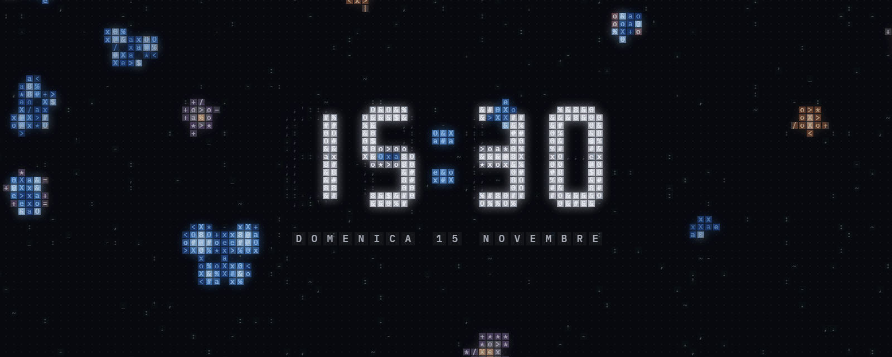
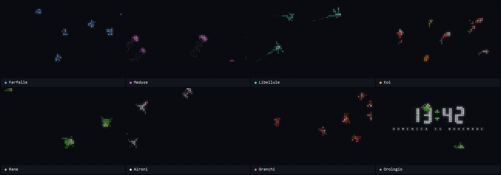
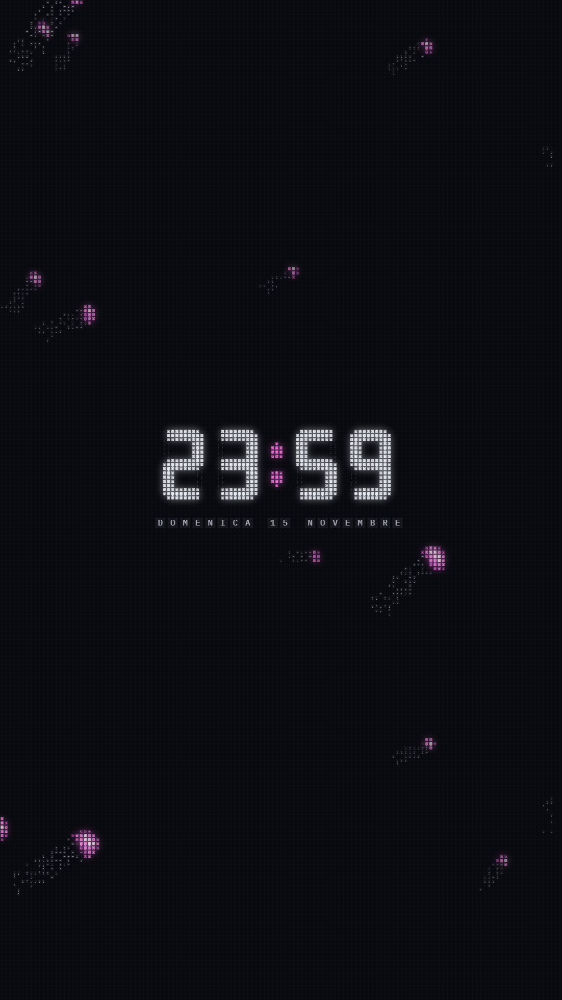

<p align="center"><a href="README.md">English</a> · <b>Italiano</b></p>

<h1 align="center">ASCII Zoo</h1>

<p align="center">
  Animali fatti di caratteri da tastiera che volano, nuotano e saltano intorno a un orologio ASCII.<br>
  Uno sfondo animato per Windows, macOS e Linux (un piccolo programma in Rust; su Windows anche con <a href="https://github.com/rocksdanister/lively">Lively Wallpaper</a>) e una nuova scheda per Firefox.
</p>

<p align="center">
  
</p>

---

## Gli animali

Sette specie, una alla volta, ognuna con il suo ambiente. Di serie lo sfondo passa alla successiva ogni 2 minuti; dal programma per Windows si sceglie ogni quanto (da 30 secondi a un'ora) e quali animali far girare. Quando il PC è in carica restano le koi nel loro stagno (si può disattivare).

<p align="center">
  
</p>

| Specie | Come si muove | L'ambiente | Con l'orologio |
|---|---|---|---|
| **Farfalle** | svolazzano a zig-zag battendo le ali | prato visto dall'alto con fiori a cinque petali che ondeggiano, si scostano e si aprono quando una farfalla ci passa vicino; ci si posano sopra | si posano sulle cifre e aprono le ali piano |
| **Meduse** | pulsano e si lasciano portare dalla corrente | fondale con raggi di luce e bolle che salgono: le meduse le spostano, contro l'orologio scoppiano | ci girano intorno |
| **Libellule** | scatti rapidi e pause a mezz'aria | canne con le spighe che salgono da una striscia d'acqua e ondeggiano; le libellule si posano sulle punte, che si piegano | si posano sulle cifre |
| **Koi** | nuotano ondeggiando la coda | stagno con acqua che scorre, ninfee alla deriva e gocce | ci girano intorno; allo scatto del minuto fuggono con un colpo di coda |
| **Rane** | saltano, si fermano, risaltano | prato con ciuffi d'erba, sassi dove si siedono, pozzanghere che schizzano quando ci atterrano, lucciole che scappano (o finiscono mangiate) | ci saltano sopra per sedersi, oppure lo scavalcano |
| **Aironi** | volano tutti nella stessa direzione, con battiti lenti | nidi di rametti con le uova: tornano, chiudono le ali e covano, e dopo un po' le uova si schiudono | ci girano intorno |
| **Granchi** | camminano di lato | sabbia con le increspature e le conchiglie, sassi da aggirare, impronte che il tempo cancella | invertono il passo quando ci arrivano contro |

Ogni animale è una forma calcolata cella per cella: ogni cella accesa diventa un carattere (`. : - = + * o x X % # & @`), più denso dove il corpo è più pieno, con un leggero bagliore.

**Nomi.** L'animale più grande di ogni specie può avere un nome, scritto sopra la testa una lettera per casella. Di serie ce l'ha solo una koi: **KARPISA**, la carpa che viene da Pisa. Gli altri nomi si danno dal menu del programma.

## I widget

Riquadri di solo testo, nello stesso stile degli animali, in un angolo dello schermo (sopra la barra delle applicazioni). Si accendono dal menu del programma, **Widget**:

```
+- nota -----------------------+
| comprare il mangime per      |
| KARPISA                      |
+------------------------------+
+- conto alla rovescia --------+
| esame di analisi             |
| mancano 12 giorni            |
+------------------------------+
+- pc -------------------------+
| cpu  [##........]  18%       |
| ram  [######....]  57%       |
| bat+ [########..]  83%       |
+------------------------------+
```

- **Nota**: una frase che resta sul desktop.
- **Conto alla rovescia**: per cosa e che giorno (`25/12/2026`); il giorno prima dice "domani!", il giorno stesso "è oggi!".
- **CPU, RAM e batteria**, aggiornati ogni 2 secondi (`bat+` = in carica). Su macOS CPU e RAM.
- **Posizione**: uno dei quattro angoli; **Schermo**: il principale, uno a scelta o tutti.

Nel browser si vedono con dati di prova aprendo `sfondo/index.html?widget=demo`.

## L'orologio

<p align="center">
  
</p>

- **Sette segmenti** disegnati con gli stessi caratteri degli animali; i segmenti spenti restano appena visibili, come su un display LCD.
- **I due punti** pulsano a ogni secondo nel colore della specie del momento.
- **La data** sta sotto, una lettera per casella.
- **Allo scatto del minuto** le cifre cambiate si ricompongono con un bordo che scintilla, parte un'onda dall'orologio, chi era posato sulle cifre vola via e chi è vicino si spaventa.
- **Chi si posa:** farfalle, libellule e rane, solo le più piccole e al massimo due alla volta, per 4–13 secondi. Gli altri animali girano intorno all'orologio, così l'ora resta sempre leggibile; anche fiori, canne, sassi e nidi stanno lontani dalle cifre.
- **Si può togliere:** voce **Orologio al centro** nel menu del programma (Windows, macOS e Linux). Senza orologio non ci sono né l'ora né la data, gli animali passano anche dal centro e fiori, canne, sassi e nidi possono stare dappertutto. Nel browser si toglie con `index.html?orologio=0`, in Lively con la casella **Orologio al centro** tra le impostazioni dello sfondo.

Le dimensioni si adattano allo schermo: funziona anche in verticale e su schermi piccoli.

<p align="center">
  
</p>

## Struttura

```
ascii-zoo/
├── sfondo/                  sfondo animato (anche pronto per Lively Wallpaper)
│   ├── index.html           tutto in un file: motore, orologio, carattere incorporato
│   ├── LivelyInfo.json      descrizione del pacchetto per Lively
│   ├── LivelyProperties.json  impostazioni in Lively (orologio al centro)
│   └── thumbnail.jpg        miniatura nella libreria di Lively
├── app/                     programma in Rust per Windows, macOS e Linux
│   ├── src/                 finestre dietro le icone, menu, nomi, rotazione, pause
│   ├── assets/              copia di sfondo/index.html incorporata nell'eseguibile
│   ├── macos/               Info.plist dell'app per macOS
│   └── build.rs, app.manifest   aspetto moderno della finestrella dei nomi
├── linux/                   install.sh (installazione con un comando) e l'icona
├── firefox/                 estensione "nuova scheda" per Firefox
│   ├── manifest.json
│   ├── index.html, app.js, zoo.js, style.css, icon.svg
│   ├── fonts/               IBM Plex Mono (SIL OFL 1.1)
│   └── LEGGIMI.txt
└── docs/                    immagini di questo README
```

## Sfondo animato per Windows

### Con il programma in Rust (consigliato)

La cartella `app/` contiene un programma che mette lo sfondo dietro le icone su tutti i monitor, senza bisogno di Lively. Si configura tutto dall'icona a forma di koi nell'area di notifica (vicino all'orologio di Windows), con un clic destro:

- **Animale**: a rotazione oppure uno fisso;
- **Rotazione**: ogni quanto cambia animale e quali animali far girare;
- **Animale per schermo**: con più monitor, un animale diverso su ognuno (koi sul portatile, meduse sull'altro…);
- **Nomi degli animali**: il nome dell'animale più grande di ogni specie;
- **Widget**: nota, conto alla rovescia, CPU/RAM/batteria (vedi [I widget](#i-widget));
- **Orologio al centro**: togliendo la spunta l'orologio sparisce e lo schermo è tutto per gli animali;
- **Clic sul desktop agli animali**: un clic in una zona vuota del desktop dà da mangiare alle koi o fa scappare gli altri animali, come nel browser;
- le pause (a batteria, con app a schermo intero, quando le finestre coprono il desktop), l'avvio con Windows.

#### Scaricarlo

Dalla pagina [**Releases**](https://github.com/Tressilloide/ascii-zoo/releases/latest) scarica `ascii-zoo.exe` (Windows 10/11, 64 bit). Non si installa: copialo in una cartella fissa, per esempio `%LOCALAPPDATA%\AsciiZoo`, e avvialo da lì, perché **Avvia con Windows** ricorda il percorso. Serve WebView2, già presente su Windows 11 e su Windows 10 aggiornato.

- **Da dove viene l'exe.** Non è mai nella repo: lo compila GitHub Actions dal sorgente del tag della versione ([`.github/workflows/build.yml`](.github/workflows/build.yml)), e il log della build è pubblico. Ogni Release riporta l'SHA256 dell'exe e ha l'attestazione di provenienza di GitHub. Per controllarli:
  ```powershell
  Get-FileHash .\ascii-zoo.exe -Algorithm SHA256
  gh attestation verify .\ascii-zoo.exe --repo Tressilloide/ascii-zoo
  ```
- **"Windows ha protetto il PC".** L'exe non è firmato, quindi al primo avvio SmartScreen lo blocca: **Ulteriori informazioni → Esegui comunque**.
- **Cosa tocca sul PC.** Scrive solo `%APPDATA%\AsciiZoo\config.json` (le impostazioni) e, se attivi **Avvia con Windows**, il valore `AsciiZoo` nella chiave `HKCU\Software\Microsoft\Windows\CurrentVersion\Run`. Non si collega a internet: lo sfondo è dentro l'exe. Per **Clic sul desktop agli animali** usa un hook del mouse di Windows (`WH_MOUSE_LL`): legge solo dove si preme il tasto sinistro, lascia sempre passare il clic e non registra niente; si spegne togliendo la spunta dal menu. Un programma non firmato che si aggancia al desktop e si mette in avvio automatico può far scattare qualche antivirus.
- **Senza eseguire niente.** Lo sfondo è solo HTML: `sfondo/index.html` si apre in qualsiasi browser (vedi sotto).

Per compilarlo da sé: [`app/README.md`](app/README.md).

### Con Lively Wallpaper

Serve [Lively Wallpaper](https://www.rocksdanister.com/lively/) (gratuito, anche dal Microsoft Store).

**Dall'app.** In Lively aggiungi un nuovo sfondo con il pulsante **+**, scegli il file `sfondo/index.html` e applicalo. Con più schermi puoi applicarlo a ognuno.

**Da riga di comando** (provato con Lively 2.5.6 dal Microsoft Store):

1. Copia la cartella `sfondo` nella libreria di Lively, con un nome a scelta (es. `asciizoo`). Per la versione Store la libreria è
   `%LOCALAPPDATA%\Packages\12030rocksdanister.LivelyWallpaper_97hta09mmv6hy\LocalCache\Local\Lively Wallpaper\Library\wallpapers\`
2. Con Lively aperto, applicalo indicando la cartella come la vede Lively (percorso virtualizzato, senza `Packages\…\LocalCache\Local`):
   ```
   Lively.exe setwp --file "%LOCALAPPDATA%\Lively Wallpaper\Library\wallpapers\asciizoo" --monitor 1
   ```
   Ripeti con `--monitor 2`, `--monitor 3` per gli altri schermi. `Lively.exe` è nella cartella `Build` dell'app, sotto `C:\Program Files\WindowsApps\12030rocksdanister.LivelyWallpaper_…`.

Da riga di comando Lively accetta solo una cartella con `LivelyInfo.json`: un `.html` passato da solo viene rifiutato ("Unsupported command import file").

### Provarlo nel browser

Apri `sfondo/index.html` in un browser qualsiasi. Aggiungendo il nome di una specie dopo `#` resta fissa quella, senza cambio ogni 2 minuti:

```
index.html#koi      index.html#meduse      index.html#granchi
```

Nel browser un clic sullo sfondo fa disperdere gli animali; con le koi invece fa cadere del cibo.

### Note

- **Prestazioni.** Lo sfondo è limitato a 30 fotogrammi al secondo, scanditi da un timer (non da `requestAnimationFrame`, che sveglierebbe la pagina a ogni aggiornamento dello schermo), e a ogni fotogramma ridisegna solo le celle cambiate: di solito una su dieci. Data e nomi stanno su un canvas a parte, ridisegnato solo quando cambiano. Il programma in Rust ferma uno schermo a batteria, con un'app a schermo intero e quando le finestre ne coprono tutto il desktop; Lively quando una finestra copre il desktop. Con `prefers-reduced-motion` gli animali vanno più piano.
- **La schermata di blocco** di Windows accetta solo immagini fisse: lì si può mettere uno screenshot dello sfondo.
- **Il desktop non risponde ai clic con Lively?** Su Windows 11 può succedere dopo che uno schermo si scollega e si ricollega. Basta riavviare Lively: icona nell'area di notifica → Esci, poi riaprilo dal menu Start.

## Sfondo animato per macOS

Lo stesso programma esiste per macOS 11 o successivo, su Mac con Apple Silicon e Intel. Dalla pagina [**Releases**](https://github.com/Tressilloide/ascii-zoo/releases/latest) scarica `ascii-zoo-macos.dmg`, aprilo e trascina **ASCII Zoo** in **Applicazioni**.

- Lo sfondo copre ogni schermo sopra l'immagine del desktop e sotto le icone del Finder, in tutti gli Spazi. Il menu è l'icona a forma di koi nella **barra dei menu**, con le stesse voci della versione Windows (al posto di "Avvia con Windows" c'è **Apri al login**).
- **"Impossibile aprire l'app".** L'app non è firmata con un certificato Apple, quindi al primo avvio macOS la blocca: apri **Impostazioni di Sistema → Privacy e sicurezza** e premi **Apri comunque**, poi conferma.
- **Da dove viene il DMG e cosa tocca**: come per Windows, lo compila GitHub Actions, ha SHA256 e attestazione (`gh attestation verify ascii-zoo-macos.dmg --repo Tressilloide/ascii-zoo`), scrive solo `~/Library/Application Support/AsciiZoo/config.json` e, se attivi **Apri al login**, `~/Library/LaunchAgents/io.github.tressilloide.asciizoo.plist`. Non si collega a internet.

## Sfondo animato per Linux

Si installa con un solo comando nel terminale:

```
curl -fsSL https://raw.githubusercontent.com/Tressilloide/ascii-zoo/main/linux/install.sh | bash
```

Se preferisci leggere lo script prima di eseguirlo, lo stesso da un clone della repo:

```
git clone https://github.com/Tressilloide/ascii-zoo.git && bash ascii-zoo/linux/install.sh
```

Lo script ([`linux/install.sh`](linux/install.sh)) compila il programma dal sorgente e lo mette nella tua cartella utente:

1. installa le librerie per compilarlo con **apt** (Ubuntu, Debian, Mint), **dnf** (Fedora) o **pacman** (Arch); chiede la password di `sudo` solo per questo;
2. installa Rust con rustup se manca, in `~/.cargo`, senza toccare il `PATH`;
3. compila il programma (la prima volta qualche minuto);
4. lo copia in `~/.local/bin/ascii-zoo` al posto della versione di prima (che ferma), aggiunge icona e voce **ASCII Zoo** nel menu delle applicazioni, lo fa partire all'accesso e lo avvia;
5. se trova una versione vecchia fatta come estensione di GNOME Shell (uuid `ascii-zoo…@…`), la spegne e la toglie, così non girano due sfondi uno sopra l'altro. Se ce n'è anche una copia di sistema per la schermata di accesso (in `/usr/share/gnome-shell/extensions`, attivata da un file in `/usr/share/gdm/dconf`), la toglie con `sudo`. Lo fa solo dopo che la versione nuova è compilata e installata.

L'icona a forma di koi compare **nella barra in alto**, con lo stesso menu delle altre versioni (al posto di "Avvia con Windows" c'è **Apri al login**). Per aggiornare si rilancia lo stesso comando (il codice scaricato resta in `~/.cache/ascii-zoo`, quindi la volta dopo si compila molto più in fretta); per togliere tutto:

```
curl -fsSL https://raw.githubusercontent.com/Tressilloide/ascii-zoo/main/linux/install.sh | bash -s -- --disinstalla
```

- **Se apt si ferma** con `unmet dependencies`: su Ubuntu capita dopo un aggiornamento di versione, quando un pacchetto resta a una build poi ritirata dall'archivio (per esempio `libbz2-1.0 1.0.8-6ubuntu0.1`) e il suo `-dev` chiede la versione dell'archivio. Lo script lo riconosce, simula il downgrade dei pacchetti interessati e, se non toglie niente, stampa il comando da lanciare; il downgrade non lo fa da solo, perché se trascinasse via altri pacchetti potrebbe togliere il desktop.
- **Ubuntu** mostra le icone nella barra in alto di serie (estensione *Ubuntu AppIndicators*). Su GNOME senza Ubuntu (Fedora, Debian…) serve l'estensione *AppIndicator and KStatusNotifierItem Support*: lo script avvisa se manca.
- **Wayland.** Wayland non permette a un programma normale di mettersi al posto dello sfondo, quindi ASCII Zoo passa da XWayland (`GDK_BACKEND=x11`) e usa una finestra di tipo "desktop", sotto tutte le altre e su tutti gli spazi di lavoro. I clic la attraversano e arrivano alle icone del desktop.
- **Cosa tocca:** `~/.local/bin/ascii-zoo`, `~/.local/share/applications/ascii-zoo.desktop`, l'icona in `~/.local/share/icons`, `~/.config/autostart/ascii-zoo.desktop` e le impostazioni in `~/.config/AsciiZoo/config.json`; toglie solo le estensioni GNOME `ascii-zoo…@…` delle versioni vecchie (vedi il punto 5). Non si collega a internet.
- Su Linux ci sono la pausa a batteria e i widget (CPU, RAM, batteria da `/proc` e `/sys`); le pause "schermo intero" e "finestre che coprono il desktop" per ora ci sono solo su Windows.

## Nuova scheda per Firefox

La cartella `firefox/` è un'estensione che mostra gli animali in ogni nuova scheda, con saluto, ora e una barra di ricerca. È la versione precedente del motore: niente orologio ASCII e niente animali che si posano.

**Provarla subito** (resta attiva fino alla chiusura di Firefox):

1. Apri `about:debugging#/runtime/this-firefox`.
2. Premi **Carica componente aggiuntivo temporaneo…** e scegli `firefox/manifest.json`.
3. Apri una nuova scheda.

**Tenerla per sempre.** Firefox installa in modo permanente solo estensioni firmate da Mozilla:

- firma gratuita per uso personale: comprimi il *contenuto* della cartella `firefox/` in uno zip (con `manifest.json` alla radice) e caricalo su [addons.mozilla.org/developers](https://addons.mozilla.org/developers/) scegliendo la distribuzione "per conto proprio". Ricevi un `.xpi` firmato da trascinare in Firefox;
- oppure, con Firefox Developer Edition o ESR, imposta `xpinstall.signatures.required` su `false` in `about:config` e installa lo zip da `about:addons` → ingranaggio → **Installa componente aggiuntivo da file**.

**Uso.** Clic sullo sfondo: gli animali si disperdono (le koi ricevono cibo). Tasti `1`–`7` cambiano animale, `H` nasconde l'interfaccia, `/` va alla ricerca. L'ingranaggio in basso a destra permette di impostare il nome per il saluto e il cambio automatico.

## Crediti

Carattere [IBM Plex Mono](https://github.com/IBM/plex), © IBM Corp., licenza SIL Open Font License 1.1 (`firefox/fonts/OFL.txt`). Nello sfondo è incorporato direttamente in `index.html`.

## Licenza

Il codice è sotto licenza [MIT](LICENSE). Il carattere IBM Plex Mono resta sotto la sua licenza SIL Open Font License 1.1 (vedi [NOTICE](NOTICE)).
