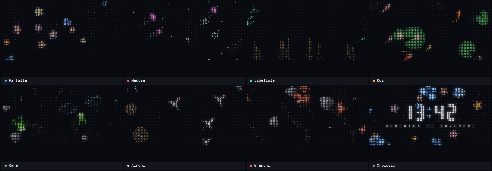
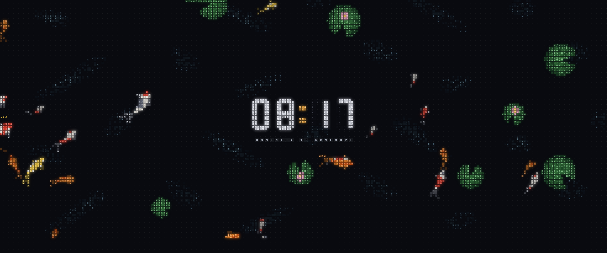
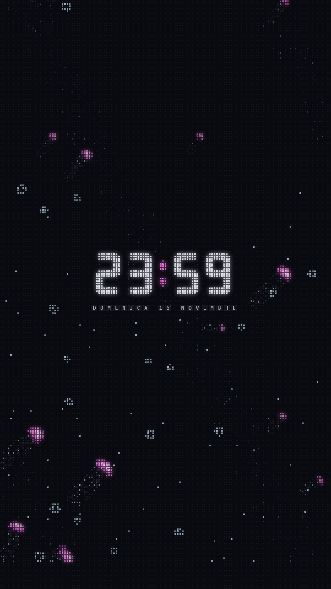

<p align="center"><a href="README.md">English</a> · <b>Italiano</b></p>

<h1 align="center">ASCII Zoo</h1>

<p align="center">
  Animali fatti di caratteri da tastiera che volano, nuotano e saltano intorno a un orologio ASCII.<br>
  Uno sfondo animato per Windows, macOS e Linux (un piccolo programma in Rust; su Windows anche con <a href="https://github.com/rocksdanister/lively">Lively Wallpaper</a>) e una nuova scheda per Firefox.
</p>

<p align="center">
  
</p>

---

## Gli animali

Nove specie, una alla volta, ognuna con il suo ambiente. Di serie lo sfondo passa alla successiva ogni 2 minuti; dal programma per Windows si sceglie ogni quanto (da 30 secondi a un'ora) e quali animali far girare. Quando il PC è in carica restano le koi nel loro stagno (si può disattivare).

<p align="center">
  
</p>

| Specie | Come si muove | L'ambiente | Con l'orologio |
|---|---|---|---|
| **Farfalle** | svolazzano a zig-zag battendo le ali | prato visto dall'alto con fiori a cinque petali che ondeggiano, si scostano e si aprono quando una farfalla ci passa vicino; ci si posano sopra | si posano sulle cifre e aprono le ali piano |
| **Meduse** | pulsano e si lasciano portare dalla corrente | fondale con raggi di luce e bolle che salgono: le meduse le spostano, contro l'orologio scoppiano | ci girano intorno |
| **Libellule** | scatti rapidi e pause a mezz'aria | canne con le spighe che salgono da una striscia d'acqua e ondeggiano; le libellule si posano sulle punte, che si piegano | si posano sulle cifre |
| **Koi** | nuotano ondeggiando la coda | stagno con acqua che scorre, ninfee alla deriva e gocce | ci girano intorno; allo scatto del minuto fuggono con un colpo di coda |
| **Rane** | saltano, si fermano, risaltano | prato con ciuffi d'erba, sassi dove si siedono, pozzanghere che schizzano quando ci atterrano, lucciole che scappano (o finiscono mangiate) | ci saltano sopra per sedersi, oppure lo scavalcano |
| **Aironi** | volano tutti nella stessa direzione, con battiti lenti | nidi di rametti con le uova: tornano, chiudono le ali e covano, e dopo un po' le uova si schiudono | ci girano intorno |
| **Granchi** | camminano di lato | sabbia con le increspature e le conchiglie, sassi da aggirare, impronte che il tempo cancella | invertono il passo quando ci arrivano contro |
| **Cavalli** | di profilo, in branco: pascolano, vanno al passo e al trotto; al clic scappano al galoppo alzando la polvere | prateria con l'erba piegata dalle raffiche di vento, fiori di campo, una staccionata in basso | lo aggirano o tornano indietro; allo scatto del minuto quelli vicini partono al galoppo |
| **Anatre** | la mamma nuota a zonzo con gli anatroccoli in fila dietro, ogni tanto mette la testa sott'acqua; qualche maschio da solo | stagno con la riva, le canne e le pannocchie, ninfee che si scostano al passaggio, la scia a V; al clic arriva il pane | ci girano intorno; allo scatto del minuto la mamma scappa e i piccoli le corrono dietro |

Ogni animale è una forma calcolata cella per cella: ogni cella accesa diventa un carattere (`. : - = + * o x X % # & @`), più denso dove il corpo è più pieno, con un leggero bagliore.

**Nomi.** L'animale più grande di ogni specie può avere un nome, scritto sopra la testa una lettera per casella. Di serie ce l'ha solo una koi: **KARPISA**, la carpa che viene da Pisa. Gli altri nomi si danno dal menu del programma.

## I widget

Riquadri di solo testo, nello stesso stile degli animali, in un angolo dello schermo (sopra la barra delle applicazioni). Si accendono dal menu del programma, **Widget**:

```
+- nota -----------------------+
| comprare il mangime per      |
| KARPISA                      |
+------------------------------+
+- conto alla rovescia --------+
| esame di analisi             |
| mancano 12 giorni            |
+------------------------------+
+- pc -------------------------+
| cpu  [##........]  18%       |
| ram  [######....]  57%       |
| bat+ [########..]  83%       |
+------------------------------+
```

- **Nota**: una frase che resta sul desktop.
- **Conto alla rovescia**: per cosa e che giorno (`25/12/2026`); il giorno prima dice "domani!", il giorno stesso "è oggi!".
- **CPU, RAM e batteria**, aggiornati ogni 2 secondi (`bat+` = in carica). Su macOS CPU e RAM.
- **Posizione**: uno dei quattro angoli; **Schermo**: il principale, uno a scelta o tutti.

Nel browser si vedono con dati di prova aprendo `wallpaper/index.html?widget=demo`.

## L'orologio

<p align="center">
  
</p>

- **Sette segmenti** disegnati con gli stessi caratteri degli animali; i segmenti spenti restano appena visibili, come su un display LCD.
- **I due punti** pulsano a ogni secondo nel colore della specie del momento.
- **La data** sta sotto, una lettera per casella.
- **Allo scatto del minuto** le cifre cambiate si ricompongono con un bordo che scintilla, parte un'onda dall'orologio, chi era posato sulle cifre vola via e chi è vicino si spaventa.
- **Chi si posa:** farfalle, libellule e rane, solo le più piccole e al massimo due alla volta, per 4–13 secondi. Gli altri animali girano intorno all'orologio, così l'ora resta sempre leggibile; anche fiori, canne, sassi e nidi stanno lontani dalle cifre.
- **Si può togliere:** voce **Orologio al centro** nel menu del programma (Windows, macOS e Linux). Senza orologio non ci sono né l'ora né la data, gli animali passano anche dal centro e fiori, canne, sassi e nidi possono stare dappertutto. Nel browser si toglie con `index.html?orologio=0`, in Lively con la casella **Orologio al centro** tra le impostazioni dello sfondo.

Le dimensioni si adattano allo schermo: funziona anche in verticale e su schermi piccoli.

<p align="center">
  
</p>

## Tema chiaro e scuro

Di serie lo sfondo è scuro: gli animali sono luce su fondo nero. Il tema **chiaro** li disegna come inchiostro su carta color crema. Non è un negativo: ogni colore tiene la sua tinta e diventa scuro quanto era chiaro sul nero, così quello che spiccava (i corpi degli animali, le cifre) spicca anche sulla carta e quello che era tenue (prato, acqua, sabbia, segmenti spenti) resta vicino al fondo; arancio, rosso e giallo restano vivi. Il bagliore intorno agli animali diventa un alone morbido, come acquerello. Vale per tutte le specie, anche per quelle che verranno, e per i widget.

- **Nel programma:** menu **Tema** → **Scuro**, **Chiaro** oppure **Come il sistema**, che segue il tema chiaro o scuro di Windows (modalità delle app), di macOS (Aspetto, anche "Automatico") o di Linux (le preferenze di aspetto del desktop, su GNOME e KDE) e cambia da solo entro un paio di secondi.
- **Nel browser:** `index.html?tema=chiaro`, `?tema=scuro` oppure `?tema=auto`, che segue il tema del sistema (`prefers-color-scheme`).
- **In Lively:** la tendina **Tema** tra le impostazioni dello sfondo.

## Foto dello sfondo

Voce **Salva una foto dello sfondo** nel menu del programma (Windows, macOS e Linux): ogni schermo salva un PNG di come appare in quel momento, alla sua risoluzione, con animali, scenografia, orologio e widget. Le foto vanno nella cartella Immagini, sottocartella **ASCII Zoo**, con data e ora nel nome (`ascii-zoo-2026-11-19-031500.png`; con più schermi `…-schermo-1.png`, `…-schermo-2.png`); un file che c'è già non viene mai sovrascritto. Poi il programma la mostra in Esplora risorse, nel Finder o nel gestore dei file di Linux. Uno schermo in pausa dà l'ultimo fotogramma, cioè quello che si vede.

Nel browser la foto si scarica con il tasto **P**.

## Struttura

```
ascii-zoo/
├── wallpaper/               sfondo animato (anche pronto per Lively Wallpaper)
│   ├── index.html           tutto in un file: motore, orologio, carattere incorporato
│   ├── LivelyInfo.json      descrizione del pacchetto per Lively
│   ├── LivelyProperties.json  impostazioni in Lively (orologio al centro, tema)
│   └── thumbnail.jpg        miniatura nella libreria di Lively
├── app/                     programma in Rust per Windows, macOS e Linux
│   ├── src/                 finestre dietro le icone, menu, nomi, rotazione, pause
│   ├── assets/              copia di wallpaper/index.html incorporata nell'eseguibile
│   ├── macos/               Info.plist dell'app per macOS
│   └── build.rs, app.manifest   aspetto moderno della finestrella dei nomi
├── dreams/                  screensaver per Windows: motore nativo con 6 scene (stelle, pioggia, fuoco…)
│   └── src/scenes/          una scena per file
├── linux/                   install.sh (installazione con un comando) e l'icona
│   └── gnome/               estensione di GNOME Shell per il clic sul desktop
├── firefox/                 estensione "nuova scheda" per Firefox
│   ├── manifest.json
│   ├── index.html, app.js, zoo.js, style.css, icon.svg
│   ├── fonts/               IBM Plex Mono (SIL OFL 1.1)
│   └── README.txt
└── docs/                    immagini di questo README
```

## Sfondo animato per Windows

### Con il programma in Rust (consigliato)

La cartella `app/` contiene un programma che mette lo sfondo dietro le icone su tutti i monitor, senza bisogno di Lively. Si configura tutto dall'icona a forma di koi nell'area di notifica (vicino all'orologio di Windows), con un clic destro:

- **Animale**: a rotazione oppure uno fisso;
- **Rotazione**: ogni quanto cambia animale e quali animali far girare;
- **Animale per schermo**: con più monitor, un animale diverso su ognuno (koi sul portatile, meduse sull'altro…);
- **Nomi degli animali**: il nome dell'animale più grande di ogni specie;
- **Widget**: nota, conto alla rovescia, CPU/RAM/batteria (vedi [I widget](#i-widget));
- **Tema**: scuro, chiaro oppure come il sistema (vedi [Tema chiaro e scuro](#tema-chiaro-e-scuro));
- **Salva una foto dello sfondo**: un PNG per schermo nella cartella Immagini (vedi [Foto dello sfondo](#foto-dello-sfondo));
- **Orologio al centro**: togliendo la spunta l'orologio sparisce e lo schermo è tutto per gli animali;
- **Clic sul desktop agli animali**: un clic in una zona vuota del desktop dà da mangiare alle koi o fa scappare gli altri animali, come nel browser;
- le pause (a batteria, con app a schermo intero, quando le finestre coprono il desktop; le stesse voci anche su macOS e Linux), l'avvio con Windows.

#### Scaricarlo

Dalla pagina [**Releases**](https://github.com/ascii-things/ascii-zoo/releases/latest) scarica `ascii-zoo.exe` (Windows 10/11, 64 bit). Non si installa: copialo in una cartella fissa, per esempio `%LOCALAPPDATA%\AsciiZoo`, e avvialo da lì, perché **Avvia con Windows** ricorda il percorso. Serve WebView2, già presente su Windows 11 e su Windows 10 aggiornato.

- **Da dove viene l'exe.** Non è mai nella repo: lo compila GitHub Actions dal sorgente del tag della versione ([`.github/workflows/build.yml`](.github/workflows/build.yml)), e il log della build è pubblico. Ogni Release riporta l'SHA256 dell'exe e ha l'attestazione di provenienza di GitHub. Per controllarli:
  ```powershell
  Get-FileHash .\ascii-zoo.exe -Algorithm SHA256
  gh attestation verify .\ascii-zoo.exe --repo ascii-things/ascii-zoo
  ```
- **"Windows ha protetto il PC".** L'exe non è firmato, quindi al primo avvio SmartScreen lo blocca: **Ulteriori informazioni → Esegui comunque**.
- **Aggiornare.** Scarica l'exe nuovo e avvialo, anche da un'altra cartella: chiude da solo la versione che sta girando (che rimette lo sfondo di Windows) e prende il suo posto. Se **Avvia con Windows** è attivo, da quel momento all'accesso parte il nuovo. L'exe vecchio non lo cancella, perché l'hai messo tu: se è in un'altra cartella toglilo a mano.
- **Cosa tocca sul PC.** Scrive solo `%APPDATA%\AsciiZoo\config.json` (le impostazioni), le foto che chiedi (in Immagini\ASCII Zoo) e, se attivi **Avvia con Windows**, il valore `AsciiZoo` nella chiave `HKCU\Software\Microsoft\Windows\CurrentVersion\Run` (che una versione nuova, se il valore c'è, fa puntare a sé). Non si collega a internet: lo sfondo è dentro l'exe. Per **Clic sul desktop agli animali** usa un hook del mouse di Windows (`WH_MOUSE_LL`): legge solo dove si preme il tasto sinistro, lascia sempre passare il clic e non registra niente; si spegne togliendo la spunta dal menu. Un programma non firmato che si aggancia al desktop e si mette in avvio automatico può far scattare qualche antivirus.
- **Senza eseguire niente.** Lo sfondo è solo HTML: `wallpaper/index.html` si apre in qualsiasi browser (vedi sotto).

Per compilarlo da sé: [`app/README.md`](app/README.md).

### Con Lively Wallpaper

Serve [Lively Wallpaper](https://www.rocksdanister.com/lively/) (gratuito, anche dal Microsoft Store).

**Dall'app.** In Lively aggiungi un nuovo sfondo con il pulsante **+**, scegli il file `wallpaper/index.html` e applicalo. Con più schermi puoi applicarlo a ognuno.

**Da riga di comando** (provato con Lively 2.5.6 dal Microsoft Store):

1. Copia la cartella `sfondo` nella libreria di Lively, con un nome a scelta (es. `asciizoo`). Per la versione Store la libreria è
   `%LOCALAPPDATA%\Packages\12030rocksdanister.LivelyWallpaper_97hta09mmv6hy\LocalCache\Local\Lively Wallpaper\Library\wallpapers\`
2. Con Lively aperto, applicalo indicando la cartella come la vede Lively (percorso virtualizzato, senza `Packages\…\LocalCache\Local`):
   ```
   Lively.exe setwp --file "%LOCALAPPDATA%\Lively Wallpaper\Library\wallpapers\asciizoo" --monitor 1
   ```
   Ripeti con `--monitor 2`, `--monitor 3` per gli altri schermi. `Lively.exe` è nella cartella `Build` dell'app, sotto `C:\Program Files\WindowsApps\12030rocksdanister.LivelyWallpaper_…`.

Da riga di comando Lively accetta solo una cartella con `LivelyInfo.json`: un `.html` passato da solo viene rifiutato ("Unsupported command import file").

### Provarlo nel browser

Apri `wallpaper/index.html` in un browser qualsiasi. Aggiungendo il nome di una specie dopo `#` resta fissa quella, senza cambio ogni 2 minuti:

```
index.html#koi      index.html#meduse      index.html#granchi
```

Nel browser un clic sullo sfondo fa disperdere gli animali; con le koi invece fa cadere del cibo.

### Note

- **Prestazioni.** Lo sfondo è limitato a 30 fotogrammi al secondo, scanditi da un timer (non da `requestAnimationFrame`, che sveglierebbe la pagina a ogni aggiornamento dello schermo), e a ogni fotogramma ridisegna solo le celle cambiate: di solito una su dieci. Data e nomi stanno su un canvas a parte, ridisegnato solo quando cambiano. Il programma in Rust ferma l'animazione quando nessuno la vede: su Windows a batteria, con un'app a schermo intero e quando le finestre coprono tutto il desktop di uno schermo; su macOS e Linux come spiegato nelle loro sezioni. Lively la ferma quando una finestra copre il desktop. Con `prefers-reduced-motion` gli animali vanno più piano.
- **La schermata di blocco** di Windows accetta solo immagini fisse: lì si può mettere uno screenshot dello sfondo.
- **Il desktop non risponde ai clic con Lively?** Su Windows 11 può succedere dopo che uno schermo si scollega e si ricollega. Basta riavviare Lively: icona nell'area di notifica → Esci, poi riaprilo dal menu Start.

## Sfondo animato per macOS

Lo stesso programma esiste per macOS 11 o successivo, su Mac con Apple Silicon e Intel. Dalla pagina [**Releases**](https://github.com/ascii-things/ascii-zoo/releases/latest) scarica `ascii-zoo-macos.dmg`, aprilo e trascina **ASCII Zoo** in **Applicazioni**.

- Lo sfondo copre ogni schermo sopra l'immagine del desktop e sotto le icone del Finder, in tutti gli Spazi. Il menu è l'icona a forma di koi nella **barra dei menu**, con le stesse voci della versione Windows (al posto di "Avvia con Windows" c'è **Apri al login**).
- **Pause.** Lo sfondo si ferma a batteria e, schermo per schermo, quando non si vede: finestre che coprono tutto il desktop, un'app a schermo intero, schermo bloccato o spento. Lo dice macOS stesso (lo stato di occlusione della finestra), senza controlli a parte; riparte entro mezzo secondo da quando torna visibile. Come su Windows, nel menu ci sono le voci **Pausa con app a schermo intero** e **Pausa quando le finestre coprono il desktop**, che si possono spegnere una per una.
- **Barra dei menu e Dock.** I widget restano fuori dalla barra dei menu e dal Dock, anche se lo sposti o lo nascondi.
- **Clic sul desktop.** Un clic sul desktop, anche sulle icone del Finder, dà da mangiare alle koi o fa scappare gli altri animali. Usa un monitor globale dei clic di macOS (`NSEvent`): vede solo dove si preme il tasto sinistro nelle altre app, non blocca né cambia il clic, non registra niente e non chiede il permesso Accessibilità (serve solo per i tasti). Il clic vale solo se nel punto non c'è nessuna finestra, il Dock o la barra dei menu. Si spegne togliendo la spunta a **Clic sul desktop agli animali**.
- **"Impossibile aprire l'app".** L'app non è firmata con un certificato Apple, quindi al primo avvio macOS la blocca: apri **Impostazioni di Sistema → Privacy e sicurezza** e premi **Apri comunque**, poi conferma.
- **Aggiornare.** Trascina la versione nuova in **Applicazioni** (sostituendo la vecchia) e aprila: chiude da sola quella che sta girando, anche se veniva da un'altra cartella, e prende il suo posto; se **Apri al login** è attivo, da quel momento all'accesso parte la nuova. Una .app vecchia in un'altra cartella non la cancella: toglila tu. **Apri al login** si attiva solo con l'app in una cartella fissa (non aperta direttamente dal DMG).
- **Da dove viene il DMG e cosa tocca**: come per Windows, lo compila GitHub Actions, ha SHA256 e attestazione (`gh attestation verify ascii-zoo-macos.dmg --repo ascii-things/ascii-zoo`), scrive solo `~/Library/Application Support/AsciiZoo/config.json`, le foto che chiedi (in `~/Pictures/ASCII Zoo`) e, se attivi **Apri al login**, `~/Library/LaunchAgents/io.github.tressilloide.asciizoo.plist`. Non si collega a internet.

## Sfondo animato per Linux

Si installa con un solo comando nel terminale:

```
curl -fsSL https://raw.githubusercontent.com/ascii-things/ascii-zoo/main/linux/install.sh | bash
```

Se preferisci leggere lo script prima di eseguirlo, lo stesso da un clone della repo:

```
git clone https://github.com/ascii-things/ascii-zoo.git && bash ascii-zoo/linux/install.sh
```

Lo script ([`linux/install.sh`](linux/install.sh)) mette il programma nella tua cartella utente:

1. scarica il programma già compilato dall'ultima [Release](https://github.com/ascii-things/ascii-zoo/releases/latest), per processori x86_64 o aarch64, e ne controlla lo SHA256. Lo compila GitHub Actions su Ubuntu 22.04, quindi va anche sulle distribuzioni più nuove;
2. installa con **apt** (Ubuntu, Debian, Mint), **dnf** (Fedora) o **pacman** (Arch) le librerie per farlo partire (WebKitGTK 4.1, GTK 3, AppIndicator, libxdo, zenity), solo se mancano; chiede la password di `sudo` solo per questo;
3. come riserva lo compila dal sorgente: se l'ultima Release non ha ancora il programma per Linux (fino alla 0.4.0 non c'era), per un altro processore, o se quello scaricato non parte. Installa allora le librerie per compilarlo, Rust con rustup se manca (in `~/.cargo`, senza toccare il `PATH`) e compila (la prima volta qualche minuto). Con `bash linux/install.sh --compila` compila sempre, dal clone in cui si trova lo script;
4. lo copia in `~/.local/bin/ascii-zoo` al posto della versione di prima (che ferma), aggiunge icona e voce **ASCII Zoo** nel menu delle applicazioni, lo fa partire all'accesso e lo avvia;
5. su GNOME 45 o successivo mette la piccola estensione per il clic sul desktop (vedi sotto);
6. se trova una versione vecchia fatta come estensione di GNOME Shell (uuid `ascii-zoo…@…`), la spegne e la toglie, così non girano due sfondi uno sopra l'altro. Se ce n'è anche una copia di sistema per la schermata di accesso (in `/usr/share/gnome-shell/extensions`, attivata da un file in `/usr/share/gdm/dconf`), la toglie con `sudo`. Lo fa solo dopo che la versione nuova è compilata e installata.

L'icona a forma di koi compare **nella barra in alto**, con lo stesso menu delle altre versioni (al posto di "Avvia con Windows" c'è **Apri al login**). Per aggiornare si rilancia lo stesso comando (se ha compilato, il codice resta in `~/.cache/ascii-zoo` e la volta dopo si compila molto più in fretta). Anche avviando a mano una copia nuova, quella che sta girando si chiude e la nuova prende il suo posto (e **Apri al login**, se attivo, passa alla nuova). Per togliere tutto:

```
curl -fsSL https://raw.githubusercontent.com/ascii-things/ascii-zoo/main/linux/install.sh | bash -s -- --disinstalla
```

- **Da dove viene il programma.** Come per Windows e macOS lo compila GitHub Actions dal sorgente del tag della versione, con il log pubblico; ogni Release riporta lo SHA256 del pacchetto (lo script lo controlla da sé) e ha l'attestazione di provenienza: `gh attestation verify ascii-zoo-linux-x86_64.tar.gz --repo ascii-things/ascii-zoo`. Il pacchetto contiene il programma, l'icona e l'estensione per il clic sul desktop.
- **Se apt si ferma** con `unmet dependencies`: su Ubuntu capita dopo un aggiornamento di versione, quando un pacchetto resta a una build poi ritirata dall'archivio (per esempio `libbz2-1.0 1.0.8-6ubuntu0.1`) e il suo `-dev` chiede la versione dell'archivio. Lo script lo riconosce, simula il downgrade dei pacchetti interessati e, se non toglie niente, stampa il comando da lanciare; il downgrade non lo fa da solo, perché se trascinasse via altri pacchetti potrebbe togliere il desktop.
- **Ubuntu** mostra le icone nella barra in alto di serie (estensione *Ubuntu AppIndicators*). Su GNOME senza Ubuntu (Fedora, Debian…) serve l'estensione *AppIndicator and KStatusNotifierItem Support*: lo script avvisa se manca.
- **Wayland.** Wayland non permette a un programma normale di mettersi al posto dello sfondo, quindi ASCII Zoo passa da XWayland (`GDK_BACKEND=x11`) e usa una finestra di tipo "desktop", sotto tutte le altre e su tutti gli spazi di lavoro. I clic la attraversano e arrivano alle icone del desktop.
- **Clic sul desktop.** Sotto Wayland un programma normale non vede i clic fatti sulle altre finestre, e su Ubuntu le icone del desktop (DING) stanno in una finestra a tutto schermo sopra lo sfondo. Su GNOME 45 o successivo (Ubuntu 23.10 e seguenti, Fedora 39 e seguenti…) lo script mette allora una piccola estensione di GNOME Shell, [`zoo-click@tressilloide.github.io`](linux/gnome/zoo-click@tressilloide.github.io/extension.js): quando premi il tasto sinistro sul desktop (anche sopra le icone di DING; non sulle finestre, sulla barra in alto o per chiudere un menu) passa il punto ad ASCII Zoo, che dà da mangiare alle koi o fa scappare gli altri animali. Non blocca né cambia il clic e non registra niente. GNOME carica le estensioni nuove solo all'accesso, quindi **funziona dal prossimo accesso**. Lavora solo mentre ASCII Zoo è acceso con **Clic sul desktop agli animali** spuntato, e si ferma quando non tocchi mouse e tastiera per 2 secondi. Con altri desktop o con GNOME più vecchio il clic sul desktop non c'è; lo sfondo funziona lo stesso.
- **Cosa tocca:** `~/.local/bin/ascii-zoo`, `~/.local/share/applications/ascii-zoo.desktop`, l'icona in `~/.local/share/icons`, `~/.config/autostart/ascii-zoo.desktop`, le impostazioni in `~/.config/AsciiZoo/config.json`, le foto che chiedi (nella cartella Immagini, sottocartella `ASCII Zoo`) e, su GNOME, l'estensione in `~/.local/share/gnome-shell/extensions/zoo-click@tressilloide.github.io` (aggiunta a quelle attive, `enabled-extensions`); toglie solo le estensioni GNOME `ascii-zoo…@…` delle versioni vecchie (vedi il punto 6). Non si collega a internet.
- **Pause.** Lo sfondo si ferma a batteria, con lo schermo bloccato o spento (salvaschermo di GNOME, o quello standard di KDE e altri desktop) e, su GNOME, quando un'app a schermo intero lo copre del tutto: GNOME rallenta i fotogrammi delle finestre che non si vedono e ASCII Zoo se ne accorge. Le finestre solo massimizzate non bastano, perché la barra in alto resta visibile. Riparte entro mezzo secondo da quando torna visibile. Nel menu ci sono le stesse voci di Windows e macOS, ma qui un'app a schermo intero e le finestre che coprono lo sfondo non si distinguono: basta una delle due voci accesa. Animarlo quando non si vede costerebbe CPU e GPU per niente: sotto Wayland ogni fotogramma passa da XWayland.
- I widget ci sono tutti, con CPU, RAM e batteria lette da `/proc` e `/sys`.

## Nuova scheda per Firefox

La cartella `firefox/` è un'estensione che mostra gli animali in ogni nuova scheda, con saluto, ora e una barra di ricerca. È la versione precedente del motore: niente orologio ASCII e niente animali che si posano.

**Provarla subito** (resta attiva fino alla chiusura di Firefox):

1. Apri `about:debugging#/runtime/this-firefox`.
2. Premi **Carica componente aggiuntivo temporaneo…** e scegli `firefox/manifest.json`.
3. Apri una nuova scheda.

**Tenerla per sempre.** Firefox installa in modo permanente solo estensioni firmate da Mozilla:

- firma gratuita per uso personale: comprimi il *contenuto* della cartella `firefox/` in uno zip (con `manifest.json` alla radice) e caricalo su [addons.mozilla.org/developers](https://addons.mozilla.org/developers/) scegliendo la distribuzione "per conto proprio". Ricevi un `.xpi` firmato da trascinare in Firefox;
- oppure, con Firefox Developer Edition o ESR, imposta `xpinstall.signatures.required` su `false` in `about:config` e installa lo zip da `about:addons` → ingranaggio → **Installa componente aggiuntivo da file**.

**Uso.** Clic sullo sfondo: gli animali si disperdono (le koi ricevono cibo). Tasti `1`–`7` cambiano animale, `H` nasconde l'interfaccia, `/` va alla ricerca. L'ingranaggio in basso a destra permette di impostare il nome per il saluto e il cambio automatico.

## Crediti

Carattere [IBM Plex Mono](https://github.com/IBM/plex), © IBM Corp., licenza SIL Open Font License 1.1 (`firefox/fonts/OFL.txt`). Nello sfondo è incorporato direttamente in `index.html`.

## Licenza

Il codice è sotto licenza [MIT](LICENSE). Il carattere IBM Plex Mono resta sotto la sua licenza SIL Open Font License 1.1 (vedi [NOTICE](NOTICE)).
