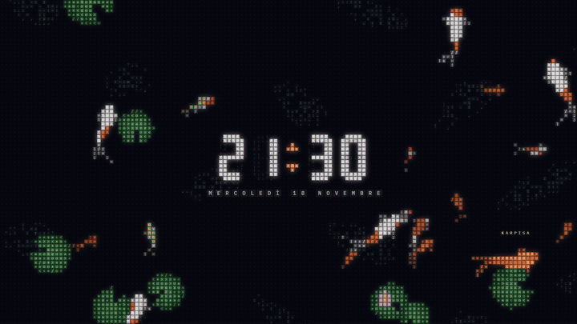
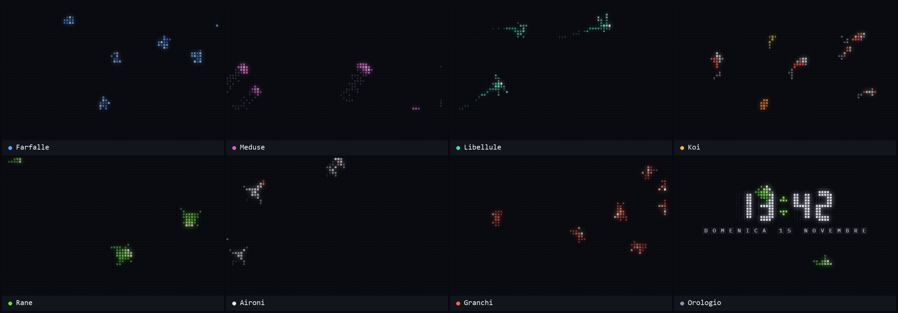

<p align="center"><b>English</b> · <a href="README.it.md">Italiano</a></p>

<h1 align="center">ASCII Zoo</h1>

<p align="center">
  <b>A living ASCII aquarium on your desktop.</b><br>
  Koi, jellyfish, butterflies, frogs and more, all made of text characters, swimming, flying and hopping behind your icons.
</p>

<p align="center">
  <a href="https://github.com/Tressilloide/ascii-zoo/releases/latest"></a>
  
  
  <a href="LICENSE"></a>
</p>

<p align="center">
  
</p>

<p align="center"><i>Click anywhere on the desktop and the koi rush to the food.</i></p>

---

## Why

Animated wallpapers are fun, but the apps that run them are often heavy, closed source or tied to a single OS.
We wanted the opposite: a **tiny, fast, open-source** live wallpaper that looks good on any desktop.

- **Light.** Under 1 MB on Windows, capped at 30 fps and redrawing only the cells that change (usually about 1 in 10). It pauses on battery, and on Windows also behind fullscreen apps and when windows cover the desktop.
- **Private.** No internet, no telemetry, no account. The whole wallpaper is a single HTML file built into the app.
- **Open.** MIT licensed, built in public, with every release compiled by GitHub Actions from the tagged source.

## Built fast, with AI

ASCII Zoo went from a browser toy to a cross-platform desktop app in a few days.
We wrote it with AI coding assistants as pair programmers: we decided what to build and how it should feel, the AI helped
with the low-level parts (Win32 desktop layering, macOS window levels, Linux tray icons, CI and signed-provenance releases),
and we checked the result on our own desktops, while CI builds every platform and launches and screenshots the app on macOS and Linux at each push.
It's a small example of what two people and an AI can ship together in a short time. Every line is here to read.

## Features

<p align="center">
  
</p>

- **7 species, 7 worlds.** Butterflies on a flower meadow, jellyfish among rising bubbles, dragonflies on reeds, koi in a pond with lily pads, frogs and fireflies, herons with nests that hatch, crabs on the sand. They rotate automatically, or you pick one.
- **An ASCII clock** they interact with: butterflies land on the digits, koi flee when the minute ticks over.
- **Click the desktop** (Windows) to feed the koi or scatter the other animals.
- **Multi-monitor**, with a different animal on each screen if you like.
- **ASCII widgets**: a sticky note, a countdown, CPU/RAM/battery meters.
- **Names**: the biggest animal of each species can carry a name. Meet **KARPISA**, the koi from Pisa.
- Everything is set from a small koi icon in the tray / menu bar.

## Download

| | |
|---|---|
| **Windows 10/11** | [`ascii-zoo.exe`](https://github.com/Tressilloide/ascii-zoo/releases/latest/download/ascii-zoo.exe): no installer, put it in a folder (e.g. `%LOCALAPPDATA%\AsciiZoo`) and run it |
| **macOS 11+** (Apple Silicon & Intel) | [`ascii-zoo-macos.dmg`](https://github.com/Tressilloide/ascii-zoo/releases/latest/download/ascii-zoo-macos.dmg): drag **ASCII Zoo** into Applications |
| **Linux** (Ubuntu, Debian, Fedora, Arch…) | one command: `curl -fsSL https://raw.githubusercontent.com/Tressilloide/ascii-zoo/main/linux/install.sh \| bash` |

**First launch.** The apps aren't code-signed (yet), so:
on Windows SmartScreen says *"Windows protected your PC"* → **More info → Run anyway**;
on macOS go to **System Settings → Privacy & Security → Open Anyway**.

**Can I trust the binary?** It's never committed to the repo: GitHub Actions builds it from the tagged source ([workflow](.github/workflows/build.yml), public logs), and every release ships a SHA256 and a GitHub provenance attestation:

```
gh attestation verify ascii-zoo.exe --repo Tressilloide/ascii-zoo
```

The app only writes its settings file (and an autostart entry, if you enable it). Full details, file locations and the Linux script steps are in the [Italian README](README.it.md).

## Try it in your browser

No install needed: open [`sfondo/index.html`](sfondo/index.html) in any browser. Add a species after `#` to keep it fixed:
`index.html#koi`, `index.html#meduse` (jellyfish), `index.html#granchi` (crabs)…

## Build from source

Rust + the platform's WebView (WebView2 / WKWebView / WebKitGTK):

```
cd app
cargo build --release --locked
```

See [`app/README.md`](app/README.md) for platform notes. Issues and pull requests are welcome, and so are new species. 🐸

## Credits & license

Code: [MIT](LICENSE). Font: [IBM Plex Mono](https://github.com/IBM/plex) © IBM Corp., SIL Open Font License 1.1.

If ASCII Zoo made your desktop a bit nicer, a ⭐ helps others find it.
