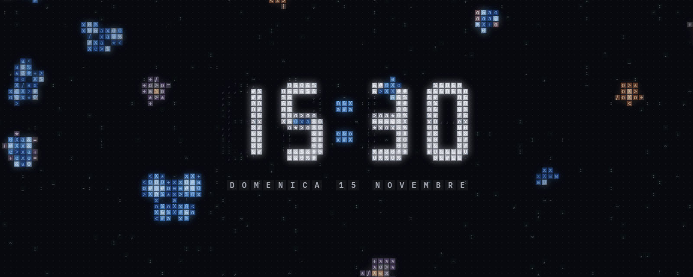
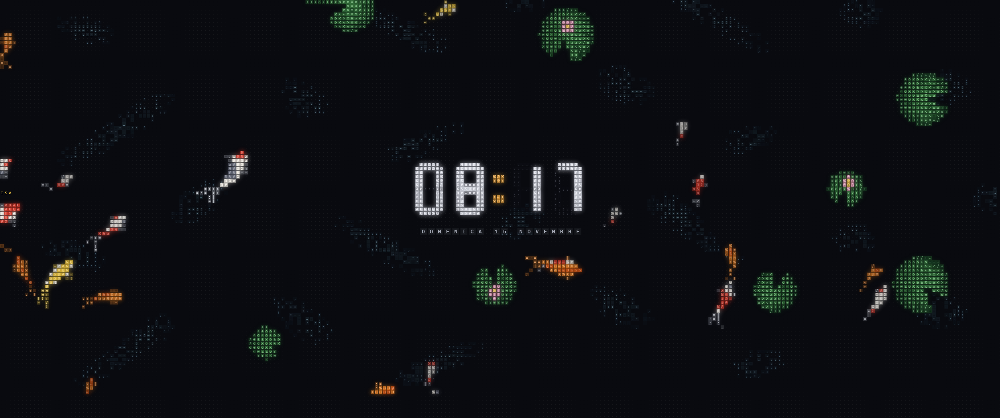
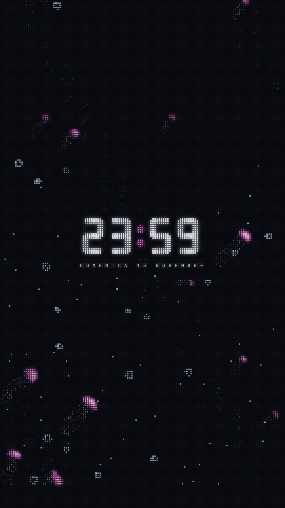

<h1 align="center">ASCII Zoo</h1>

<p align="center">
  Animali fatti di caratteri da tastiera che volano, nuotano e saltano intorno a un orologio ASCII.<br>
  Uno sfondo animato per Windows (un piccolo programma in Rust, oppure <a href="https://github.com/rocksdanister/lively">Lively Wallpaper</a>) e una nuova scheda per Firefox.
</p>

<p align="center">
  
</p>

---

## Gli animali

Sette specie, una alla volta, ognuna con il suo ambiente. Di serie lo sfondo passa alla successiva ogni 2 minuti; dal programma per Windows si sceglie ogni quanto (da 30 secondi a un'ora) e quali animali far girare. Quando il PC è in carica restano le koi nel loro stagno (si può disattivare).

<p align="center">
  
</p>

| Specie | Come si muove | L'ambiente | Con l'orologio |
|---|---|---|---|
| **Farfalle** | svolazzano a zig-zag battendo le ali | prato visto dall'alto con fiori a cinque petali che ondeggiano, si scostano e si aprono quando una farfalla ci passa vicino; ci si posano sopra | si posano sulle cifre e aprono le ali piano |
| **Meduse** | pulsano e si lasciano portare dalla corrente | fondale con raggi di luce e bolle che salgono: le meduse le spostano, contro l'orologio scoppiano | ci girano intorno |
| **Libellule** | scatti rapidi e pause a mezz'aria | canne con le spighe che salgono da una striscia d'acqua e ondeggiano; le libellule si posano sulle punte, che si piegano | si posano sulle cifre |
| **Koi** | nuotano ondeggiando la coda | stagno con acqua che scorre, ninfee alla deriva e gocce | ci girano intorno; allo scatto del minuto fuggono con un colpo di coda |
| **Rane** | saltano, si fermano, risaltano | prato con ciuffi d'erba, sassi dove si siedono, pozzanghere che schizzano quando ci atterrano, lucciole che scappano (o finiscono mangiate) | ci saltano sopra per sedersi, oppure lo scavalcano |
| **Aironi** | volano tutti nella stessa direzione, con battiti lenti | nidi di rametti con le uova: tornano, chiudono le ali e covano, e dopo un po' le uova si schiudono | ci girano intorno |
| **Granchi** | camminano di lato | sabbia con le increspature e le conchiglie, sassi da aggirare, impronte che il tempo cancella | invertono il passo quando ci arrivano contro |

Ogni animale è una forma calcolata cella per cella: ogni cella accesa diventa un carattere (`. : - = + * o x X % # & @`), più denso dove il corpo è più pieno, con un leggero bagliore.

**Nomi.** L'animale più grande di ogni specie può avere un nome, scritto sopra la testa una lettera per casella. Di serie ce l'ha solo una koi: **KARPISA**, la carpa che viene da Pisa. Gli altri nomi si danno dal menu del programma per Windows.

## L'orologio

<p align="center">
  
</p>

- **Sette segmenti** disegnati con gli stessi caratteri degli animali; i segmenti spenti restano appena visibili, come su un display LCD.
- **I due punti** pulsano a ogni secondo nel colore della specie del momento.
- **La data** sta sotto, una lettera per casella.
- **Allo scatto del minuto** le cifre cambiate si ricompongono con un bordo che scintilla, parte un'onda dall'orologio, chi era posato sulle cifre vola via e chi è vicino si spaventa.
- **Chi si posa:** farfalle, libellule e rane, solo le più piccole e al massimo due alla volta, per 4–13 secondi. Gli altri animali girano intorno all'orologio, così l'ora resta sempre leggibile; anche fiori, canne, sassi e nidi stanno lontani dalle cifre.

Le dimensioni si adattano allo schermo: funziona anche in verticale e su schermi piccoli.

<p align="center">
  
</p>

## Struttura

```
ascii-zoo/
├── sfondo/                  sfondo animato (anche pronto per Lively Wallpaper)
│   ├── index.html           tutto in un file: motore, orologio, carattere incorporato
│   ├── LivelyInfo.json      descrizione del pacchetto per Lively
│   └── thumbnail.jpg        miniatura nella libreria di Lively
├── app/                     programma per Windows in Rust: lo sfondo senza Lively
│   ├── src/                 finestre dietro le icone, menu, nomi, rotazione, pause
│   ├── assets/              copia di sfondo/index.html incorporata nell'eseguibile
│   └── build.rs, app.manifest   aspetto moderno della finestrella dei nomi
├── firefox/                 estensione "nuova scheda" per Firefox
│   ├── manifest.json
│   ├── index.html, app.js, zoo.js, style.css, icon.svg
│   ├── fonts/               IBM Plex Mono (SIL OFL 1.1)
│   └── LEGGIMI.txt
└── docs/                    immagini di questo README
```

## Sfondo animato per Windows

### Con il programma in Rust (consigliato)

La cartella `app/` contiene un programma che mette lo sfondo dietro le icone su tutti i monitor, senza bisogno di Lively. Si configura tutto dall'icona a forma di koi nell'area di notifica (vicino all'orologio di Windows), con un clic destro:

- **Animale**: a rotazione oppure uno fisso;
- **Rotazione**: ogni quanto cambia animale e quali animali far girare;
- **Nomi degli animali**: il nome dell'animale più grande di ogni specie;
- le pause (a batteria, con app a schermo intero), l'avvio con Windows.

Istruzioni per compilarlo in [`app/README.md`](app/README.md).

### Con Lively Wallpaper

Serve [Lively Wallpaper](https://www.rocksdanister.com/lively/) (gratuito, anche dal Microsoft Store).

**Dall'app.** In Lively aggiungi un nuovo sfondo con il pulsante **+**, scegli il file `sfondo/index.html` e applicalo. Con più schermi puoi applicarlo a ognuno.

**Da riga di comando** (provato con Lively 2.5.6 dal Microsoft Store):

1. Copia la cartella `sfondo` nella libreria di Lively, con un nome a scelta (es. `asciizoo`). Per la versione Store la libreria è
   `%LOCALAPPDATA%\Packages\12030rocksdanister.LivelyWallpaper_97hta09mmv6hy\LocalCache\Local\Lively Wallpaper\Library\wallpapers\`
2. Con Lively aperto, applicalo indicando la cartella come la vede Lively (percorso virtualizzato, senza `Packages\…\LocalCache\Local`):
   ```
   Lively.exe setwp --file "%LOCALAPPDATA%\Lively Wallpaper\Library\wallpapers\asciizoo" --monitor 1
   ```
   Ripeti con `--monitor 2`, `--monitor 3` per gli altri schermi. `Lively.exe` è nella cartella `Build` dell'app, sotto `C:\Program Files\WindowsApps\12030rocksdanister.LivelyWallpaper_…`.

Da riga di comando Lively accetta solo una cartella con `LivelyInfo.json`: un `.html` passato da solo viene rifiutato ("Unsupported command import file").

### Provarlo nel browser

Apri `sfondo/index.html` in un browser qualsiasi. Aggiungendo il nome di una specie dopo `#` resta fissa quella, senza cambio ogni 2 minuti:

```
index.html#koi      index.html#meduse      index.html#granchi
```

Nel browser un clic sullo sfondo fa disperdere gli animali; con le koi invece fa cadere del cibo.

### Note

- **Prestazioni.** Lo sfondo è limitato a 30 fotogrammi al secondo. Il programma in Rust lo mette in pausa a batteria e sullo schermo di un'app a schermo intero; Lively quando una finestra copre il desktop. Con `prefers-reduced-motion` gli animali vanno più piano.
- **La schermata di blocco** di Windows accetta solo immagini fisse: lì si può mettere uno screenshot dello sfondo.
- **Il desktop non risponde ai clic con Lively?** Su Windows 11 può succedere dopo che uno schermo si scollega e si ricollega. Basta riavviare Lively: icona nell'area di notifica → Esci, poi riaprilo dal menu Start.

## Nuova scheda per Firefox

La cartella `firefox/` è un'estensione che mostra gli animali in ogni nuova scheda, con saluto, ora e una barra di ricerca. È la versione precedente del motore: niente orologio ASCII e niente animali che si posano.

**Provarla subito** (resta attiva fino alla chiusura di Firefox):

1. Apri `about:debugging#/runtime/this-firefox`.
2. Premi **Carica componente aggiuntivo temporaneo…** e scegli `firefox/manifest.json`.
3. Apri una nuova scheda.

**Tenerla per sempre.** Firefox installa in modo permanente solo estensioni firmate da Mozilla:

- firma gratuita per uso personale: comprimi il *contenuto* della cartella `firefox/` in uno zip (con `manifest.json` alla radice) e caricalo su [addons.mozilla.org/developers](https://addons.mozilla.org/developers/) scegliendo la distribuzione "per conto proprio". Ricevi un `.xpi` firmato da trascinare in Firefox;
- oppure, con Firefox Developer Edition o ESR, imposta `xpinstall.signatures.required` su `false` in `about:config` e installa lo zip da `about:addons` → ingranaggio → **Installa componente aggiuntivo da file**.

**Uso.** Clic sullo sfondo: gli animali si disperdono (le koi ricevono cibo). Tasti `1`–`7` cambiano animale, `H` nasconde l'interfaccia, `/` va alla ricerca. L'ingranaggio in basso a destra permette di impostare il nome per il saluto e il cambio automatico.

## Crediti

Carattere [IBM Plex Mono](https://github.com/IBM/plex), © IBM Corp., licenza SIL Open Font License 1.1 (`firefox/fonts/OFL.txt`). Nello sfondo è incorporato direttamente in `index.html`.
